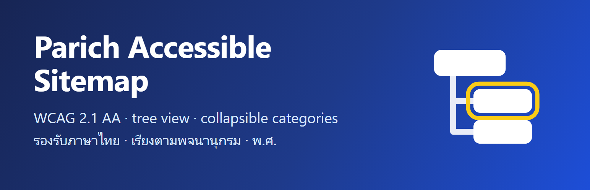

# Parich Accessible Sitemap

An accessible (WCAG 2.1 AA) HTML sitemap for WordPress: a block and a shortcode that list your pages, posts by category, other content types and taxonomies, archives and authors — as a tree, with collapsible categories, and with full Thai language support.

- **Accessible:** a labelled navigation landmark, real headings (level 2–6), nested lists, a table of contents with "Back to contents" links, `aria-current`, visible focus, reflow at 320px, Windows contrast themes and print.
- **Thai:** Thai translation (as a language pack from translate.wordpress.org), Buddhist Era years (พ.ศ.), and Thai titles in dictionary order (words starting with เ แ โ ใ ไ sorted by their consonant).
- **Fast on large sites:** cached and rebuilt when content changes, posts loaded in batches without their content, optional limit of posts per category.
- **Coming from WP Sitemap Page:** settings are copied on first run and `[wp_sitemap_page]` shortcodes keep working.

The user documentation — every shortcode option, FAQ and filters — is in [readme.txt](readme.txt), the same text as on WordPress.org.

## Install

- **WordPress.org:** Plugins → Add New Plugin → search for "Parich Accessible Sitemap" (once the plugin is approved in the directory).
- **ZIP:** download `parich-accessible-sitemap.zip` from [Releases](https://github.com/parich/parich-accessible-sitemap/releases) and upload it under Plugins → Add New Plugin → Upload Plugin. Updates then come from WordPress.org (same slug).

Then add the **Parich Accessible Sitemap** block to a page, or the `[parich_sitemap]` shortcode.

## Development

Requires Node.js 22+, and for the tests a local WordPress 6.7+ site with PHP 7.4+ (the tests run against it inside a database transaction that is rolled back).

```bash
npm install
npm run build        # src/ -> build/ (build/ is committed)
npm start            # watch mode
npm run lint:js && npm run lint:css
npm run i18n         # .pot, Thai .po/.mo and editor JSON in languages/ (needs WP-CLI; used by the tests, not shipped)
npm test             # PHP tests, axe-core, reflow at 320px, high contrast and print
npm run plugin-zip   # parich-accessible-sitemap.zip
```

For the PHP tests, copy `tests/local-config.example.json` to `tests/local-config.json` and fill in your PHP binary, php.ini and WP-CLI paths. The browser checks use Edge or Chrome (headless). The release steps are in [RELEASE.md](RELEASE.md).

## Credits and license

Forked from [WP Sitemap Page](https://wordpress.org/plugins/wp-sitemap-page/) 1.9.6 by Tony Archambeau. Released under the [GNU General Public License v2 or later](https://www.gnu.org/licenses/gpl-2.0.html).

If the plugin is useful to you, you can [make a donation](https://buy.stripe.com/3cIaEW9699pf3dyeAfaMU00). Thank you!
